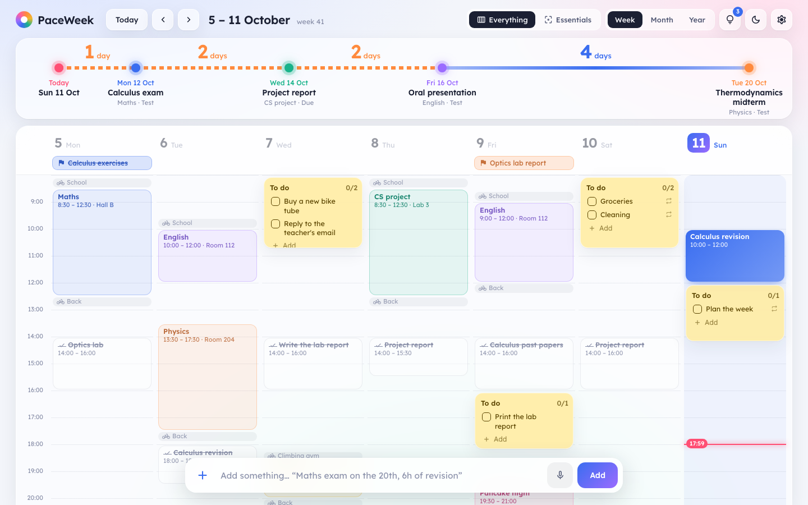
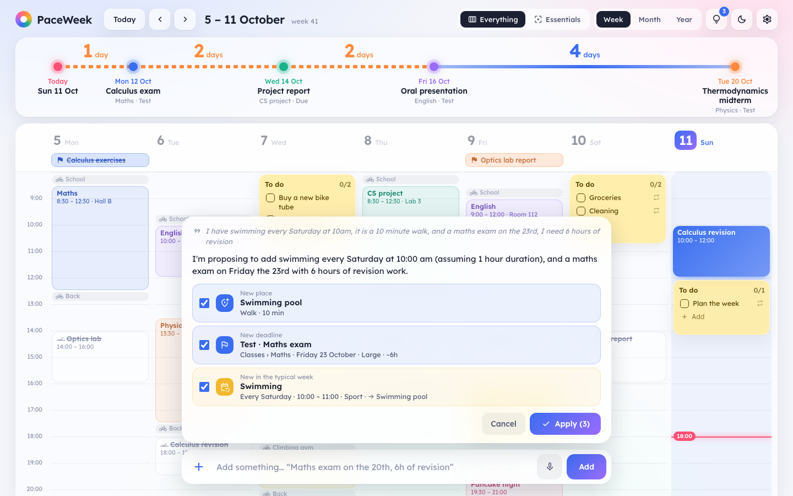
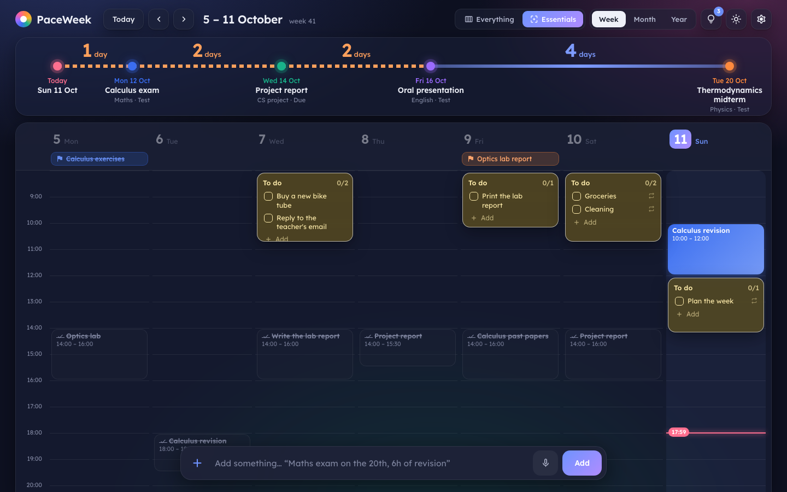
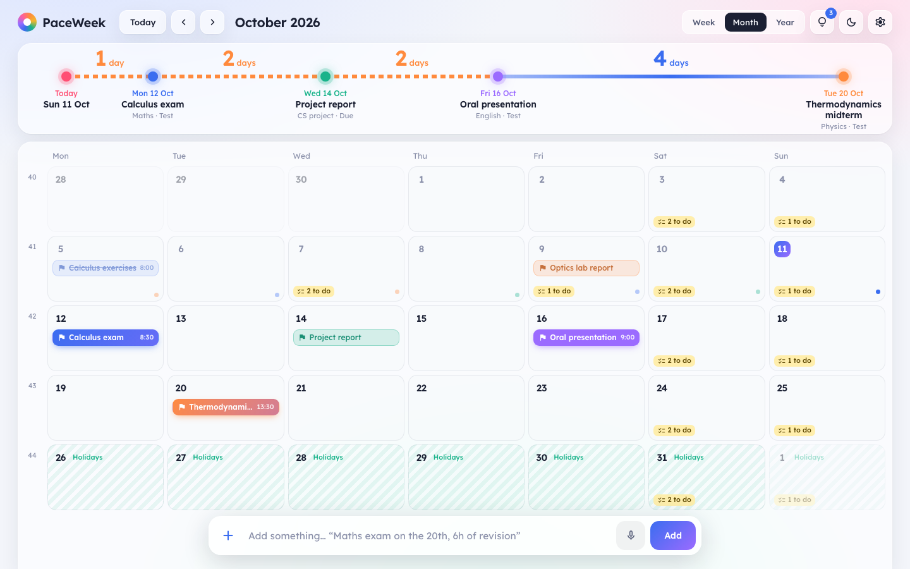

# PaceWeek

**Your week at a glance, and a bar where you just say what you need to do.**

PaceWeek is a personal weekly planner for Mac, Windows and Linux. At the top, a timeline shows your upcoming deadlines and how many days lie between them. Below it, your week: classes, work, sport, travel, study sessions and small things to tick off.

## How it works

1. **Set up your typical week** on first launch: classes, work hours, sport… It comes back every week on its own. You can also import an `.ics` calendar.
2. **Add your deadlines**: assignments, exams, goals. The timeline lines them up and makes busy stretches stand out.
3. **Say what you need to do**, typed or spoken: *"Maths exam on the 23rd, I need 6 hours of revision."* PaceWeek suggests study sessions in your free time, and always shows you what it understood before changing anything.
4. **Travel time is handled for you**: each place has its own way of getting there and duration, and PaceWeek adds the trip there and back.

  
  

Your data stays **on your computer**. Dictation is transcribed on your computer too, and the assistant works with the AI of your choice (Claude, ChatGPT, Gemini, or a local model), or with no AI at all. Available in English and French.

## Download

Get the latest version from [**Releases**](../../releases/latest):

- **Mac** (Apple Silicon and Intel): the `.dmg`. Drag PaceWeek into Applications. The first time, **right-click → Open**. If macOS still blocks it, go to **System Settings → Privacy & Security** and click **Open Anyway**.
- **Windows**: the `-setup.exe`. If Windows shows a warning, click "More info", then "Run anyway".
- **Linux**: the `.AppImage` (make it executable, then run it) or the `.deb`.

After that, PaceWeek offers new versions by itself. Your data is never touched by an update.

## Terms

PaceWeek is **free for personal use**. It remains the property of its author: selling, modifying or redistributing it is not allowed. The full terms are in [LICENSE.md](LICENSE.md).

This repository only holds the installers. The source code is not public.

© 2026 Thomas Sager. All rights reserved.
